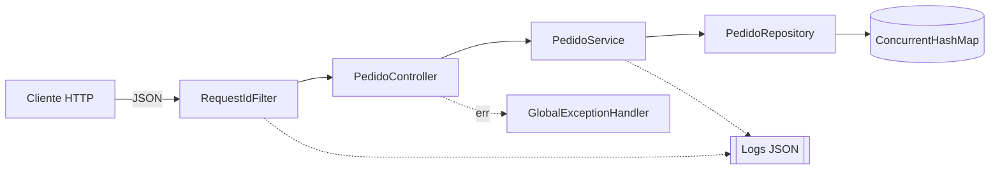

# CP5 - API de Pedidos

Checkpoint 5 de Arquitetura Orientada a Serviço (3ESPY - 2026).

## Integrantes

Arthur Cotrick Pagani | RM554510 </br>
Diogo Leles Franciulli | RM558487  </br>
Felipe Sousa de Oliveira | RM559085  </br>
Ryan Brito Pereira Ramos | RM554497  </br>

## Tecnologias

- Java 21
- Spring Boot 3.5 (Spring Web + Validation)
- springdoc-openapi (Swagger UI)
- Maven
- JUnit 5 + MockMvc para os testes
- Logs em JSON usando o structured logging do próprio Spring Boot (formato logstash)

Os pedidos ficam salvos em memória em um `ConcurrentHashMap`, então não precisa de banco. Quando a aplicação reinicia os dados são perdidos.

## Arquitetura



Separamos a aplicação em camadas:

- **RequestIdFilter** (`config`): toda requisição passa por ele primeiro. Gera um `requestId` (ou usa o que vier no header `X-Request-ID`), coloca no MDC do log e devolve no header da resposta. Também loga quando a requisição chega e quando termina, com o status e o tempo.
- **PedidoController** (`controller`): entrada HTTP. Recebe o JSON, valida com Bean Validation e chama o service. Retorna 201 na criação e 200 na consulta.
- **PedidoService** (`service`): regra de negócio. Gera o id (UUID), define o status como `CRIADO` e a data de criação. Se o pedido não existir lança `PedidoNaoEncontradoException`.
- **PedidoRepository** (`repository`): guarda e busca os pedidos no map em memória.
- **GlobalExceptionHandler** (`exception`): transforma as exceções em resposta JSON com o status certo (404 para pedido inexistente, 400 para dados inválidos).

## Endpoints

| Método | Rota | Descrição | Status |
|---|---|---|---|
| POST | `/pedidos` | Cria um pedido | 201, 400 |
| GET | `/pedidos/{id}` | Busca um pedido pelo id | 200, 404 |

### Swagger / OpenAPI

A documentação é gerada automaticamente a partir dos controllers com o springdoc-openapi (anotações `@Tag`, `@Operation` e `@ApiResponse` no `PedidoController`). Com a API rodando:

- Swagger UI: http://localhost:8080/swagger-ui.html
- Spec em JSON: http://localhost:8080/v3/api-docs
- Spec em YAML: http://localhost:8080/v3/api-docs.yaml

Uma cópia da especificação também está no repositório em [`docs/openapi.yaml`](docs/openapi.yaml).

## Como rodar

Precisa ter o JDK 21 instalado. O projeto tem o Maven Wrapper, então não precisa instalar o Maven.

```bash
# Linux / Mac
./mvnw spring-boot:run

# Windows
mvnw.cmd spring-boot:run
```

A API sobe em `http://localhost:8080`. Também dá pra rodar direto pela IDE executando a classe `PedidosApiApplication`.

### Exemplos

**Criar pedido**

```bash
curl -i -X POST http://localhost:8080/pedidos \
  -H "Content-Type: application/json" \
  -d '{"cliente": "Maria Silva", "descricao": "2 camisetas pretas tamanho M", "valor": 159.90}'
```

Resposta `201 Created`:

```json
{
  "id": "7d3f0a2e-5c1b-4f7e-9a61-2b8c4e0d9f13",
  "cliente": "Maria Silva",
  "descricao": "2 camisetas pretas tamanho M",
  "valor": 159.90,
  "status": "CRIADO",
  "dataCriacao": "2026-10-21T20:15:42.318"
}
```

**Consultar pedido**

```bash
curl -i http://localhost:8080/pedidos/7d3f0a2e-5c1b-4f7e-9a61-2b8c4e0d9f13
```

Resposta `200 OK` com o mesmo JSON do pedido.

**Consultar pedido que não existe**

```bash
curl -i http://localhost:8080/pedidos/123
```

Resposta `404 Not Found`:

```json
{
  "status": 404,
  "erro": "Not Found",
  "mensagem": "Pedido 123 não encontrado",
  "requestId": "c41e9b07-6a2f-4b8d-a3c5-7e0f1d2b9a64",
  "timestamp": "2026-10-21T20:17:11.540"
}
```

**Criar pedido com valor inválido**

```bash
curl -i -X POST http://localhost:8080/pedidos \
  -H "Content-Type: application/json" \
  -d '{"cliente": "Ana", "descricao": "Caneca", "valor": -10}'
```

Resposta `400 Bad Request` com a mensagem `valor deve ser maior que zero`.

## Testes

Os testes ficam em `src/test/java/br/com/fiap/pedidos/PedidoControllerTest.java`. Usamos `@SpringBootTest` com MockMvc, que faz as requisições na API e verifica o resultado:

- `deveCriarPedidoComStatusCriado`: faz o POST e verifica se voltou 201, o header `Location`, o id preenchido e o status `CRIADO`
- `deveRetornar404QuandoPedidoNaoExiste`: faz o GET de um id que não existe e verifica se voltou 404
- `deveRetornar400QuandoValorForNegativo`: faz o POST com valor negativo e verifica se voltou 400

Para rodar:

```bash
./mvnw test
```

### Evidência

<!-- colar aqui a saída do ./mvnw test (ou o print em docs/evidencias/) -->

```
COLAR AQUI A SAÍDA DO ./mvnw test
```

## Logs

Os logs saem em JSON no console (configurado no `application.properties` com `logging.structured.format.console=logstash`). O `requestId` é colocado no MDC pelo `RequestIdFilter`, então todos os logs de uma mesma requisição saem com o mesmo id. Nos logs de negócio também vai o `pedidoId` e o campo `operacao` (`HTTP_REQUEST`, `CRIAR_PEDIDO`, `CONSULTAR_PEDIDO`, `VALIDACAO`, `HTTP_RESPONSE`).

Cada linha tem pelo menos: `@timestamp`, `level`, `message`, `requestId` e `operacao`.

### Evidência

<!-- colar aqui alguns logs gerados ao fazer as requisições de exemplo (ou o print em docs/evidencias/) -->

```json
COLAR AQUI OS LOGS
```
